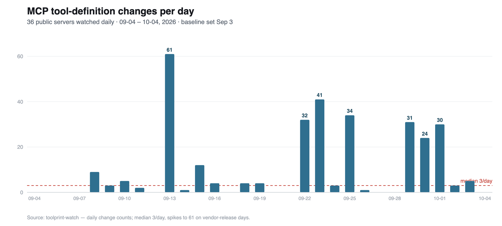
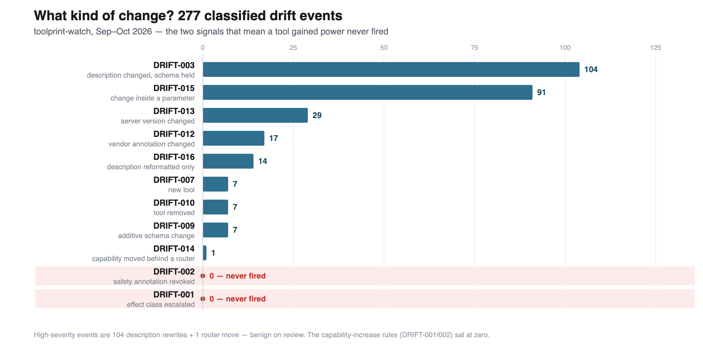

# MCP Tool Definitions Drift Constantly — and Almost Nobody Is Watching

### I monitored 36 public MCP servers every day for five weeks. The tools kept changing out from under their users — but not in the way the security field expects.

When you connect an AI agent to a Model Context Protocol (MCP) server, you're trusting that server to define what your agent can do: the tools it exposes, the parameters they take, and the natural-language descriptions that steer the model's decisions. You review it once, approve it, and move on.

But the server doesn't move on. It ships new versions, and those definitions change — with no notification to anyone downstream. I wanted to know how often that actually happens, and whether any of it is the kind of change that should worry you. So I built a monitor.

## How I measured it

[`toolprint-watch`](https://github.com/dit4e/toolprint-watch) scans 36 public MCP servers once a day, compares each one's advertised tool definitions against an approved baseline, and records every change. The baseline's git history *is* the dataset — every commit is a diff with a timestamp. Everything comes from the servers' own published packages, installed the way any user installs them, with no credentials.

One design choice makes the result trustworthy: the watchlist is split into three tiers, including a set of **archived, frozen servers as a control group**. Those should never change. If drift shows up there, it's a measurement problem, not a finding. (The full tiering and method are in [`METHODOLOGY.md`](https://github.com/dit4e/toolprint-watch/blob/main/METHODOLOGY.md).)

## Change is constant

Over the five weeks charted above, a tool definition on a watched server changed, on a typical day, about three times across the fleet — with quiet days punctuated by vendor-release spikes as high as 61 in a single day. The rhythm is a flat baseline near three changes a day, jumping sharply whenever a vendor ships. And it's concentrated: **a handful of vendors drive most of it**, one of them releasing so often it's effectively continuous. The frozen control group, meanwhile, didn't move — exactly as it should.

> The thing you approved is rarely the thing running now.

## But what *kind* of change?

This is where it gets interesting. "The tools change a lot" could mean anything. So I classified every change by what it was.

Across the charted window, **277 changes classified cleanly into a rule.** The overwhelming majority are two kinds: **description rewrites** (104) and **edits inside a parameter** — a default, a constraint, a field description (91). The wording that steers the agent, and the fine print of what it accepts, churn constantly. Below those sit version bumps (29), a scattering of new tools (7) and removed tools (7), and reformatting.

And at the very bottom, at **zero**: the two rules that would actually mean *a tool gained power* — an effect-class escalation (a read tool becoming one that can write, send, or delete) and a revoked safety annotation. In five weeks of the most active servers in the ecosystem, neither fired once.

To be honest about the description count, because "the description changed" can be noise: I hand-sampled 30 of them. 24 were genuine content edits, **zero** were formatting or environmental noise, and 6 couldn't be reconstructed from retained data. The churn is real, not an artifact — and it clusters by release (a single vendor release rewrote boilerplate across more than a dozen tools at once).

*(The monitor has kept running since this chart's cutoff. In the longer run, the two power-gaining signals did eventually fire — twice — and I checked both by hand: each was an annotation flip with an identical schema, one of them a vendor* correcting *an over-permissive label. Neither was a real read→write transition.)*

## Why "boring" is the real finding

The threat the security field scans for in MCP is the **rug pull**: a tool you trusted quietly gaining dangerous capability in an update. It's the scenario every MCP scanner is built to catch.

Across five weeks of live monitoring — and, in separate work, roughly 1,600 historical release transitions I diffed across 22 months — I haven't seen it happen in mainstream servers. Not once unexplained. What I see instead is **constant, unreviewed churn**: low-drama on any given day, but it means the definition your agent runs today is probably not the one you signed off on.

That reframes the problem. The gap isn't better *detection* of an attack that mostly isn't occurring in these servers. The gap is **basic change control** for a layer most teams can't even see — the agent's tool surface, changing faster than anyone reviews it, trusted by default.

## Run it yourself

The monitor, the full dataset, and the chart generator are open:

- [`toolprint-watch`](https://github.com/dit4e/toolprint-watch) — the daily monitor and the data
- [`toolprint`](https://github.com/dit4e/toolprint) — the scanner underneath it

If you operate agents on MCP servers, the uncomfortable question is simple: **how would you know if a server you depend on changed what its tools can do last week?** Right now, most teams wouldn't.

*I'll keep publishing what the monitor finds. Follow along if that's useful.*

---

**Suggested tags:** `MCP` · `AI Agents` · `AI Security` · `Model Context Protocol` · `DevSecOps`
